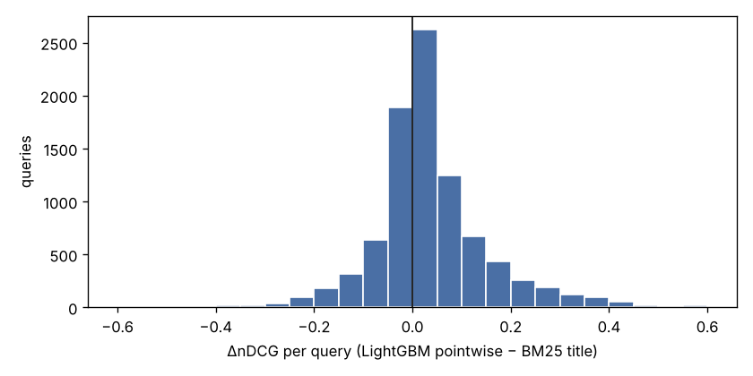

# Report 3 — Final test (official test split, scored once)

Chosen model (frozen in Report 2): **LightGBM pointwise** `{"num_leaves": 15, "min_data_in_leaf": 100}`, 793 rounds. All models and preprocessing were refit on the full training split with frozen settings.

Test queries evaluated: 8,956 (excluded for ideal DCG = 0: 0). 95% CIs: 1,000 bootstrap resamples of test queries, the same resamples for every method (paired).

Test run log: 1 scoring run(s); first at 2026-10-20 08:42:15 with Report 2 commit `3024bcbd641e22cedb086ccc0e94dc4b8273c809 2026-10-20T08:02:50+00:00`.

## 1. Main results (all test queries)

| Method | nDCG | nDCG@5 | Exact-P@1 |
|---|---|---|---|
| Random (20 seeds) | 0.7469 [0.7440, 0.7498] | 0.5022 [0.4981, 0.5063] | 0.4356 [0.4302, 0.4410] |
| BM25 title | 0.8176 [0.8144, 0.8208] | 0.6380 [0.6322, 0.6436] | 0.6203 [0.6105, 0.6305] |
| BM25 all fields | 0.8204 [0.8170, 0.8239] | 0.6446 [0.6388, 0.6504] | 0.6226 [0.6120, 0.6323] |
| Encoder cosine (zero-shot) | 0.8280 [0.8248, 0.8310] | 0.6577 [0.6523, 0.6632] | 0.6396 [0.6292, 0.6490] |
| Logistic regression | 0.8498 [0.8467, 0.8526] | 0.7040 [0.6984, 0.7090] | 0.7012 [0.6907, 0.7098] |
| LightGBM pointwise | 0.8538 [0.8507, 0.8569] | 0.7132 [0.7079, 0.7185] | 0.7157 [0.7063, 0.7249] |
| LightGBM LambdaRank | 0.8541 [0.8511, 0.8572] | 0.7119 [0.7067, 0.7171] | 0.7136 [0.7039, 0.7229] |

| Paired difference | ΔnDCG | ΔnDCG@5 | ΔExact-P@1 |
|---|---|---|---|
| model - bm25_title | 0.0362 [0.0337, 0.0386] | 0.0752 [0.0699, 0.0800] | 0.0955 [0.0852, 0.1053] |
| model - bm25_all | 0.0333 [0.0309, 0.0359] | 0.0687 [0.0639, 0.0738] | 0.0931 [0.0830, 0.1036] |
| model - encoder_cosine | 0.0258 [0.0236, 0.0279] | 0.0555 [0.0515, 0.0596] | 0.0762 [0.0665, 0.0864] |
| model - random | 0.1069 [0.1042, 0.1097] | 0.2111 [0.2060, 0.2165] | 0.2801 [0.2708, 0.2891] |

Gap random → BM25-title: +0.0708 nDCG. Chosen model − BM25-title: +0.0362 (= 51% of the random → BM25 gap).

Other models vs BM25-title (paired):

| Paired difference | ΔnDCG | ΔnDCG@5 | ΔExact-P@1 |
|---|---|---|---|
| logreg - bm25_title | 0.0322 [0.0297, 0.0345] | 0.0660 [0.0609, 0.0707] | 0.0810 [0.0708, 0.0908] |
| lgbm_pointwise - bm25_title | 0.0362 [0.0337, 0.0386] | 0.0752 [0.0699, 0.0800] | 0.0955 [0.0852, 0.1053] |
| lgbm_lambdarank - bm25_title | 0.0365 [0.0341, 0.0387] | 0.0739 [0.0688, 0.0786] | 0.0933 [0.0834, 0.1029] |

## 2. Without the 101 near-duplicate test queries (spec §4.3)

| Method | nDCG | nDCG@5 | Exact-P@1 |
|---|---|---|---|
| Random (20 seeds) | 0.7465 [0.7437, 0.7493] | 0.5017 [0.4976, 0.5057] | 0.4349 [0.4298, 0.4402] |
| BM25 title | 0.8174 [0.8143, 0.8205] | 0.6376 [0.6320, 0.6427] | 0.6200 [0.6103, 0.6290] |
| BM25 all fields | 0.8205 [0.8172, 0.8238] | 0.6449 [0.6389, 0.6506] | 0.6235 [0.6133, 0.6335] |
| Encoder cosine (zero-shot) | 0.8278 [0.8249, 0.8308] | 0.6575 [0.6522, 0.6628] | 0.6393 [0.6290, 0.6490] |
| Logistic regression | 0.8495 [0.8465, 0.8523] | 0.7034 [0.6979, 0.7087] | 0.7004 [0.6908, 0.7095] |
| LightGBM pointwise | 0.8535 [0.8505, 0.8564] | 0.7129 [0.7075, 0.7179] | 0.7152 [0.7055, 0.7240] |
| LightGBM LambdaRank | 0.8538 [0.8508, 0.8567] | 0.7115 [0.7059, 0.7164] | 0.7128 [0.7032, 0.7216] |

| Paired difference | ΔnDCG | ΔnDCG@5 | ΔExact-P@1 |
|---|---|---|---|
| model - bm25_title | 0.0361 [0.0336, 0.0384] | 0.0752 [0.0704, 0.0803] | 0.0952 [0.0845, 0.1055] |
| model - bm25_all | 0.0330 [0.0305, 0.0355] | 0.0680 [0.0628, 0.0731] | 0.0917 [0.0805, 0.1014] |
| model - encoder_cosine | 0.0257 [0.0236, 0.0279] | 0.0554 [0.0514, 0.0597] | 0.0759 [0.0662, 0.0857] |
| model - random | 0.1070 [0.1041, 0.1097] | 0.2112 [0.2057, 0.2160] | 0.2803 [0.2703, 0.2894] |

## 3. Per-query comparison with BM25-title

Win / tie / loss (nDCG, chosen model vs BM25-title): **5549 / 189 / 3218**.

## 4. Error analysis by query category

Categories are rule-based taggers on the query text (`scripts/categories.py`). `substitute_heavy` uses labels and is **analysis-only**.

| Category | Queries | BM25-title nDCG | Model nDCG | ΔnDCG vs BM25-title [95% CI] | ΔnDCG vs encoder | Win / loss |
|---|--:|---|---|---|---|---|
| numeric | 1,833 | 0.7917 | 0.8337 | 0.0420 [0.0366, 0.0480] | 0.0430 [0.0371, 0.0489] | 1151 / 655 |
| negation | 760 | 0.7634 | 0.8098 | 0.0465 [0.0383, 0.0554] | 0.0473 [0.0384, 0.0564] | 489 / 266 |
| brand_in_query | 1,168 | 0.8228 | 0.8618 | 0.0390 [0.0328, 0.0455] | 0.0321 [0.0258, 0.0381] | 739 / 395 |
| colour_in_query | 876 | 0.8229 | 0.8542 | 0.0312 [0.0236, 0.0386] | 0.0258 [0.0175, 0.0326] | 539 / 324 |
| short | 1,717 | 0.8130 | 0.8571 | 0.0441 [0.0379, 0.0503] | 0.0228 [0.0177, 0.0275] | 1084 / 595 |
| long | 1,290 | 0.8036 | 0.8360 | 0.0324 [0.0260, 0.0388] | 0.0310 [0.0243, 0.0371] | 784 / 474 |
| substitute_heavy *(analysis-only)* | 3,066 | 0.7820 | 0.8265 | 0.0445 [0.0400, 0.0492] | 0.0423 [0.0383, 0.0465] | 1898 / 1080 |

Largest gain over BM25-title: **negation** (0.0465 [0.0383, 0.0554]). Smallest gain: **colour_in_query** (0.0312 [0.0236, 0.0386]).

## 5. 15 queries where the model helps most

**amazon valentine offuce** — ΔnDCG +0.755 (BM25 0.245 → model 1.000)

- BM25 top 3: `I` Amazon Basics Woodcased #2 Pencils, Pre-sharpened, HB Lead - · `I` Amazon Brand - Lark & Ro Women's Classic Cap Sleeve V-Neck C · `I` Amazon Basics Narrow Ruled 5 x 8-Inch Writing Pad - White (5
- Model top 3: `E` Love Doctor's Office - Valentine's Day Heart Surgery · `I` The Office: Season 2 · `I` Houseboat
- Diagnosis: BM25 #1 is I, model #1 is E; model #1 vs BM25 #1 contribution gap: meaning similar to title+bullets +0.10, spelling-level overlap +0.08

**onses for men** — ΔnDCG +0.730 (BM25 0.270 → model 1.000)

- BM25 top 3: `I` Onse Upon A Time There Was A Girl Who Really Loved Elephants · `I` Alph-onse Full Metal Alch-emist Backpacks Cute Patterns Prin · `I` Knee Sleeves (SOLD AS A PAIR of 2) for Cross Training Squats
- Model top 3: `E` Disney Men's Finding Dory Uniform Union Suit, Blue, L · `I` Onse Upon A Time There Was A Girl Who Really Loved Elephants · `I` Riparo Mens Genuine Leather Reverse Stitched Half-Finger Dri
- Diagnosis: BM25 #1 is I, model #1 is E; model #1 vs BM25 #1 contribution gap: meaning score vs other candidates -0.05, keyword match in title +0.03

**hanukkah hats** — ΔnDCG +0.727 (BM25 0.261 → model 0.988)

- BM25 top 3: `I` Big Dot of Happiness Happy Hanukkah - Hanukkah & Chanukah Ph · `I` MAGA Dreidel Dreidel Make America Great Again - Hanukkah Dra · `I` Dreidel Headbands - Fun for Hanukkah - Personal Decorations 
- Model top 3: `E` Happy Chanukah Plush Hat Standard · `I` Menorah Headbands - Fun for Hanukkah - Personal Decorations  · `S` Forum Novelties 81672 Chanukah Hat Oy, Multi-Color, One Size
- Diagnosis: BM25 #1 is I, model #1 is E; model #1 vs BM25 #1 contribution gap: keyword match in title +0.09, spelling-level overlap +0.09

**entertainment stand for tv up to 90** — ΔnDCG +0.721 (BM25 0.279 → model 1.000)

- BM25 top 3: `I` FURINNO JAYA Large Entertainment Stand for TV Up to 50 Inch, · `I` VASAGLE TV Stand, TV Cabinet for TVs up to 43 Inches, Mid-Ce · `I` Ameriwood Home Carson TV Stand for TVs up to 70", Cherry
- Model top 3: `E` MEBLE FURNITURE & RUGS TV Stand Roma Matte Body High Gloss D · `I` FURINNO JAYA Large Entertainment Stand for TV Up to 50 Inch, · `I` VASAGLE TV Stand, TV Cabinet for TVs up to 43 Inches, Mid-Ce
- Diagnosis: BM25 #1 is I, model #1 is E; model #1 vs BM25 #1 contribution gap: query words found anywhere +0.15, number conflicts with query +0.10

**I want a replacement chrome book with a touch screen. So really it would be an upgrade. I want a large screen and a good memory** — ΔnDCG +0.710 (BM25 0.290 → model 1.000)

- BM25 top 3: `I` Baby/Toddler/Kid 'I See It, I Like It, I Want It, DAD Bought · `I` ActRaise I Couldn’t Become a Hero, So I Reluctantly Decided  · `I` Jellycat Board Books, If I were a Panda
- Model top 3: `E` Lenovo Chromebook C330 2-in-1 Convertible Laptop, 11.6-Inch  · `S` Lenovo Chromebook S330 Laptop, 14-Inch FHD (1920 x 1080) Dis · `I` When This Virus is Over Graphic Novelty Sarcastic Funny T Sh
- Diagnosis: BM25 #1 is I, model #1 is E; model #1 vs BM25 #1 contribution gap: meaning similar to title+bullets +0.23, query length +0.11

**moto g7 play** — ΔnDCG +0.648 (BM25 0.352 → model 1.000)

- BM25 top 3: `C` Moto G7 Play Case, Moto G7 Play Phone Case, HNHYGETE Soft Sl · `C` Moto G7 Play Case (Not Fit Moto G7) with [2 Pack] Tempered G · `C` Moto G7 Play Rugged Clear Case, Moto G7 Optimo Case, Poetic 
- Model top 3: `E` Moto G7 play | Unlocked | Made for US by Motorola | 2/32GB | · `E` Moto G7 Play with Alexa Push-to-Talk – Unlocked – 32 GB – De · `C` G7 Play LCD Screen Replacement Touch Display Digitizer Assem
- Diagnosis: BM25 #1 is C, model #1 is E; model #1 vs BM25 #1 contribution gap: meaning score vs other candidates +0.07, keyword score vs other candidates -0.06

**google watch for women** — ΔnDCG +0.644 (BM25 0.356 → model 1.000)

- BM25 top 3: `I` Star Trek Next Generation 2021 Bluetooth Communicator Badge  · `I` Playz Bath Bomb Bonanza Science Activity, Craft, & Experimen · `I` Pricetitution Card Game (from Shark Tank!) - Game Nights, Di
- Model top 3: `E` Wakmr Smart Wristband Thermometer Pedometer Sports Fitness A · `I` Makkalen Wooden Bank Safe Money Box Savings with Lock Wood C · `I` Sacow PC Micro USB Cable Male Host to USB Female OTG Adapter
- Diagnosis: BM25 #1 is I, model #1 is E; model #1 vs BM25 #1 contribution gap: query words found anywhere +0.20, keyword score vs other candidates +0.12

**batman dvd** — ΔnDCG +0.638 (BM25 0.359 → model 0.998)

- BM25 top 3: `I` DC Direct Batman Year One DVD Batman Maquette · `I` DC Direct Superman/Batman: Public Enemies DVD Batman Maquett · `I` The Batman - EXP Extreme Power - Batman Action Figure with B
- Model top 3: `E` LEGO Batman 3: Beyond Gotham (PC DVD) · `C` Batman DVD Player with Remote Control · `I` DC Direct Batman Year One DVD Batman Maquette
- Diagnosis: BM25 #1 is I, model #1 is E; model #1 vs BM25 #1 contribution gap: meaning similar to title+bullets +0.07, no colour listed -0.01

**happypills** — ΔnDCG +0.604 (BM25 0.396 → model 1.000)

- BM25 top 3: `I` Joy-Filled | 100% Plant-Based Supplement for Anxiety Relief  · `I` Dr. Emil Nutrition 200 MG 5-HTP Plus Formula for Mood, Stres · `I` Dr. Emil Nutrition Organic Lions Mane Mushroom Capsule with 
- Model top 3: `E` Brain Pharma Happy Pills, 60 Count · `E` Just For Laughs Happy Pill Giggling Plush 6-Pack · `E` Happy Pills
- Diagnosis: BM25 #1 is I, model #1 is E; model #1 vs BM25 #1 contribution gap: spelling-level overlap +0.17, keyword match in title +0.03

**cordless wall hanging fountains** — ΔnDCG +0.587 (BM25 0.413 → model 1.000)

- BM25 top 3: `I` Cordless LED Orb RGB Sphere Lamp with Remote, 6 Inch Color C · `I` 4-Pack Solar Powered Mason Jar Lights (Mason Jar & Handle In · `I` LeiDrail Solar Lantern Outdoor Christmas Hanging Lanterns Ga
- Model top 3: `E` WICHEMI Tabletop Water Fountain with Rolling Ball, Feng Shui · `E` iPettie Clover LED Light Pet Water Fountain 2.3L/78oz, Ultra · `E` Sunnydaze Solar Water Fountain with Battery Backup - Modern 
- Diagnosis: BM25 #1 is I, model #1 is E; model #1 vs BM25 #1 contribution gap: keyword score vs other candidates -0.08, meaning similar to title+bullets +0.07

**xiaomi mi 9t pro** — ΔnDCG +0.583 (BM25 0.410 → model 0.993)

- BM25 top 3: `C` Ferilinso Case for Xiaomi Mi 9T /Mi 9T Pro,Ultra [Slim Thin] · `C` [2 Pack] QHOHQ Screen Protector for Xiaomi Mi 9T / 9T Pro,[F · `C` Ferilinso Screen Protector for Xiaomi Mi 9T /Xiaomi Mi 9T Pr
- Model top 3: `E` Xiaomi Mi 9T Pro (128GB, 6GB RAM) 6.39" Display, Snapdragon  · `S` Xiaomi Mi 9T (128GB, 6GB RAM) 6.39" AMOLED FHD + Full Screen · `S` Xiaomi Mi 9T (64GB, 6GB RAM) 6.39" AMOLED FHD + Full Screen 
- Diagnosis: BM25 #1 is C, model #1 is E; model #1 vs BM25 #1 contribution gap: brand conflicts with query +0.09, meaning score vs other candidates +0.08

**iphone 8 screen protector not plus** — ΔnDCG +0.579 (BM25 0.419 → model 0.998)

- BM25 top 3: `I` Tech Armor HD Clear Film Screen Protector (Not Glass) for Ap · `I` Purity Glass Screen Protector for iPhone 8 Plus / 7 Plus (3- · `I` uShield Privacy Screen Protector for iPhone 8 Plus, iPhone 7
- Model top 3: `E` Ailun 0.33mm Screen Protector Compatible for iPhone 8,7,6s,6 · `E` amFilm Screen Protector for iPhone SE (2020), 8, 7, 6S, 6 (3 · `E` Power Theory Designed for iPhone 8 Screen Protector/iPhone 7
- Diagnosis: BM25 #1 is I, model #1 is E; model #1 vs BM25 #1 contribution gap: title has the excluded term +0.22, query words found anywhere +0.05

**peanuts christmas sheet music** — ΔnDCG +0.569 (BM25 0.431 → model 1.000)

- BM25 top 3: `I` Linus and Lucy - Peanuts - Sheet Music - Charlie Brown Theme · `I` The Peanuts Music Activity Book: An Introduction to Music · `I` Hal Leonard - Vince Guaraldi: A Charlie Brown Christmas Shee
- Model top 3: `E` The Peanuts Christmas Carol Collection (Easy Piano (Hal Leon · `I` A Charlie Brown Christmas - Easy Piano Songbook · `I` The Peanuts Music Activity Book: An Introduction to Music
- Diagnosis: BM25 #1 is I, model #1 is E; model #1 vs BM25 #1 contribution gap: no brand listed +0.06, spelling-level overlap +0.04

**jeans clothing** — ΔnDCG +0.569 (BM25 0.431 → model 1.000)

- BM25 top 3: `I` FabStix Retro Lipstick Iron on Patch or Sticker Applique for · `I` (5 Sheets) Baby Iron On Transfers Patches Set, MWOOT Kids Ap · `I` Versace Versace Versus Blue Jeans - Edt Spray 2.5 Oz, 2.5 oz
- Model top 3: `E` Women's Mid Rise Shorts Teen Girls Summer Slim Fit Frayed Ra · `I` (5 Sheets) Baby Iron On Transfers Patches Set, MWOOT Kids Ap · `I` FabStix Retro Lipstick Iron on Patch or Sticker Applique for
- Diagnosis: BM25 #1 is I, model #1 is E; model #1 vs BM25 #1 contribution gap: query words found anywhere -0.16, meaning similar to title+bullets +0.12

**bettervent** — ΔnDCG +0.567 (BM25 0.364 → model 0.931)

- BM25 top 3: `C` Essential Values 12 Pack Compatible Replacement Filters (60  · `C` (Pack of 18) 7" x 8-1/4" - Replacement Polyester Filters for · `S` Continental Fan Lint Trap
- Model top 3: `E` BetterVent Indoor Dryer Vent - Protects Indoor Air Quality a · `C` BetterVent Polyester Filter Replacements - Official Manufact · `C` Polyester Lint Trap Dryer Filter Replacement Part Compatible
- Diagnosis: BM25 #1 is C, model #1 is E; model #1 vs BM25 #1 contribution gap: meaning similar to title+bullets +0.13, meaning score vs other candidates +0.11

## 6. 15 queries where the model hurts most

**projectors** — ΔnDCG -0.706 (BM25 1.000 → model 0.294)

- BM25 top 3: `E` CK Global Brand Projector User Manual PDF Files for NEC NP-V · `C` Hologram Watch, 3D Hologram Smartphone Holographic Display S · `C` PPJ USB 2.0 Cable Cord A to B for Acer XD1150 DLP Projector,
- Model top 3: `C` USlingbi Universal Pyramid Display Projector, 3D Hologram Py · `C` Hologram Watch, 3D Hologram Smartphone Holographic Display S · `C` Govt LP250 LCD Projector - D/Ship Only
- Diagnosis: BM25 #1 is E, model #1 is C; model #1 vs BM25 #1 contribution gap: meaning score vs other candidates +0.11, meaning similar to title+bullets +0.10

**tidy die** — ΔnDCG -0.613 (BM25 1.000 → model 0.387)

- BM25 top 3: `E` Cool Maker, Tidy Dye Station, Fashion Activity Kit for Kids  · `I` TONIC STUDIOS Table Tidy-Single Pocket, Polyester, Multicolo · `I` The Icarus Line Must Die
- Model top 3: `I` TONIC STUDIOS Table Tidy-Single Pocket, Polyester, Multicolo · `I` TONIC STUDIOS Large Ring Binder Die Case, 4.4400000000000004 · `I` Gemini Tote Bag, Purple
- Diagnosis: BM25 #1 is E, model #1 is I; model #1 vs BM25 #1 contribution gap: meaning score vs other candidates +0.06, meaning similar to title+bullets +0.03

**live not by lives** — ΔnDCG -0.568 (BM25 0.972 → model 0.404)

- BM25 top 3: `E` Live Not by Lies: A Manual for Christian Dissidents · `I` Live Your Life, Not Your Diagnosis: How to Manage Stress and · `I` Life Is Not a Dress Rehearsal: Live, Love and Be Happy!
- Model top 3: `I` Get Money: Live the Life You Want, Not Just the Life You Can · `I` You Don't Need Anyone's Permission to Live Your Best Life!:  · `I` I Will Not Die an Unlived Life: Reclaiming Purpose and Passi
- Diagnosis: BM25 #1 is E, model #1 is I; model #1 vs BM25 #1 contribution gap: meaning similar to title+bullets +0.10, meaning score vs other candidates +0.08

**womens brown snow pants** — ΔnDCG -0.535 (BM25 0.930 → model 0.395)

- BM25 top 3: `E` Arctix Women's Insulated Snow Pants, Black, Medium Tall · `I` Sorel Women's 1964 Premium CVS Snow Boot, Camel Brown, 8.5 M · `I` DREAM PAIRS Women's DP-Avalanche Brown Faux Fur Lined Mid Ca
- Model top 3: `I` DREAM PAIRS Women's DP-Avalanche Brown Faux Fur Lined Mid Ca · `I` Sorel Women's 1964 Premium CVS Snow Boot, Camel Brown, 8.5 M · `S` PUMA Women's Fenty Sweatsuit Pant, Friar Brown, S
- Diagnosis: BM25 #1 is E, model #1 is I; model #1 vs BM25 #1 contribution gap: colour conflicts with query +0.15, word overlap with title +0.05

**benjamin toy** — ΔnDCG -0.518 (BM25 1.000 → model 0.482)

- BM25 top 3: `E` Steiff 355257 Benjamin Bunny 26cm · `E` Accoutrements Benjamin Franklin Action Figure · `I` Child Benjamin Franklin Wig Standard
- Model top 3: `I` The Classic Tale of Benjamin Bunny · `I` The Tale of Benjamin Bunny (Peter Rabbit) · `I` Child Benjamin Franklin Wig Standard
- Diagnosis: BM25 #1 is E, model #1 is I; model #1 vs BM25 #1 contribution gap: meaning similar to title+bullets +0.08, meaning score vs other candidates +0.03

**iphone xr usb** — ΔnDCG -0.511 (BM25 0.969 → model 0.458)

- BM25 top 3: `E` Hirkase Micro USB Cable iPhone, 1M Nylon Braided Samsung USB · `C` 2-Pack Universal Cable Bite, Mini Cartoon Charging Cable Pro · `C` 2-Pack Universal Cable Bite, Mini Cartoon Charging Cable Pro
- Model top 3: `C` Car Charger DBHAWK New Dual USB Port Car Charger Multi - Fun · `C` Dual Port USB Wall Charger, Tuscom USB Plug Power Adapter Tr · `C` AxiBa USB C Car Charger, 12W 3.1A PowerDrive Speed+ Duo, 2 P
- Diagnosis: BM25 #1 is E, model #1 is C; model #1 vs BM25 #1 contribution gap: meaning score vs other candidates +0.06, query words found anywhere +0.02

**insulated tumbler bulk** — ΔnDCG -0.501 (BM25 0.955 → model 0.454)

- BM25 top 3: `E` Fasclot Thermos Cup Wine Tumbler with Lid, Double Wall Vacuu · `C` Celiy Hand Shank 30 Oz Stainless Steel Insulated Tumbler Mug · `I` 30oz Tumbler Handle (GREEN) by STRATA CUPS - Available For 3
- Model top 3: `I` Skinny Steel Cup Lid for 20 oz Tumblers · `C` Celiy Hand Shank 30 Oz Stainless Steel Insulated Tumbler Mug · `I` 30oz Tumbler Handle (GREEN) by STRATA CUPS - Available For 3
- Diagnosis: BM25 #1 is E, model #1 is I; model #1 vs BM25 #1 contribution gap: meaning similar to title+bullets +0.10, keyword match in title +0.08

**tempered chocolate kit** — ΔnDCG -0.500 (BM25 1.000 → model 0.500)

- BM25 top 3: `E` Wilton Chocolate Pro Melting Chocolate Candy Wafers for Choc · `I` Merckens Coating Melting Wafers Chocolate White 10 pounds · `I` DecoBros Crystal Tempered Glass Nespresso OriginalLine Stora
- Model top 3: `I` Merckens Coating Melting Wafers Chocolate White 10 pounds · `I` Stainless Steel Double Boiler Pot for Melting Chocolate, Can · `E` Wilton Chocolate Pro Melting Chocolate Candy Wafers for Choc
- Diagnosis: BM25 #1 is E, model #1 is I; model #1 vs BM25 #1 contribution gap: spelling-level overlap +0.04, keyword match in title +0.03

**red wood cross necklace** — ΔnDCG -0.500 (BM25 1.000 → model 0.500)

- BM25 top 3: `E` Vibrant Red Green 20.5 Wood Beaded Children's Rosary · `I` LiboboNew Fashion Wood Beads Bracelets Boho Small Elephant C · `I` Origami Folding Paper,Simplylin Children's Toys Manual DIY S
- Model top 3: `I` LiboboNew Fashion Wood Beads Bracelets Boho Small Elephant C · `I` Simplylin_Bracelets Needle Felting Kit by Handmade,Simplylin · `E` Vibrant Red Green 20.5 Wood Beaded Children's Rosary
- Diagnosis: BM25 #1 is E, model #1 is I; model #1 vs BM25 #1 contribution gap: query words found anywhere +0.18, first query word in title -0.05

**usa wras** — ΔnDCG -0.499 (BM25 0.959 → model 0.460)

- BM25 top 3: `E` Japanese American Resettlement through the Lens: Hikaru Iwas · `S` Stargate - The Ark of Truth · `I` Under Wraps
- Model top 3: `I` Under Wraps · `S` T-34: Russia's Armoured Spearhead (TankCraft) · `S` The One and Only [Blu-ray]
- Diagnosis: BM25 #1 is E, model #1 is I; model #1 vs BM25 #1 contribution gap: spelling-level overlap +0.11, title length -0.05

**saphire** — ΔnDCG -0.494 (BM25 0.922 → model 0.427)

- BM25 top 3: `E` Peora Created Blue Sapphire with Genuine Diamond Pendant in  · `E` Amazon Essentials Sterling Silver Round Cut Created Blue Sap · `I` Saphir Natural Horsehair Shoe Brush for Leather Shining, Buf
- Model top 3: `I` Saphir Creme Surfine Cream Shoe Polish Black 50ml · `I` Saphir Medaille d'Or Pommadier Cream 75ml - Black · `I` Sapphire & Steel: The Complete Series
- Diagnosis: BM25 #1 is E, model #1 is I; model #1 vs BM25 #1 contribution gap: spelling-level overlap +0.06, meaning score vs other candidates +0.04

**homegoing yaa gyasi paperback** — ΔnDCG -0.489 (BM25 1.000 → model 0.511)

- BM25 top 3: `E` Homegoing · `C` Summary of Homegoing: by Yaa Gyasi | Includes Analysis · `C` Homegoing by Yaa Gyasi (Book Analysis): Detailed Summary, An
- Model top 3: `C` Summary of Homegoing: by Yaa Gyasi | Includes Analysis · `C` Homegoing by Yaa Gyasi (Book Analysis): Detailed Summary, An · `E` Homegoing
- Diagnosis: BM25 #1 is E, model #1 is C; model #1 vs BM25 #1 contribution gap: meaning similar to title+bullets +0.09, no brand listed -0.07

**halloween window boards** — ΔnDCG -0.470 (BM25 0.974 → model 0.504)

- BM25 top 3: `E` Fun World Haunted Window Boards Standard · `I` Halloween Window Clings Decoration Bats Spiders Weepa 68 Pcs · `I` Holiday Designs Halloween and Fall Window Cling Decorations 
- Model top 3: `I` Holiday Designs Halloween and Fall Window Cling Decorations  · `I` Halloween Window Clings Decoration Bats Spiders Weepa 68 Pcs · `E` Fun World Haunted Window Boards Standard
- Diagnosis: BM25 #1 is E, model #1 is I; model #1 vs BM25 #1 contribution gap: spelling-level overlap -0.08, word overlap with title +0.05

**mini bikes for adults 200cc** — ΔnDCG -0.462 (BM25 0.983 → model 0.521)

- BM25 top 3: `E` X-PRO 200cc Adult Gas Motorcycle Street Moped Scooter Lifan  · `S` Massimo Motor MB200 196CC Engine Super Size Mini Moto Trail  · `S` Massimo Motor MB200 196CC Engine Super Size Mini Moto Trail 
- Model top 3: `S` 125cc Dirt Bike Pit Bike Adults Dirtbikes Pitbikes 125 Dirt  · `S` Massimo Motor MB200 196CC Engine Super Size Mini Moto Trail  · `S` 110cc Dirt Bike Pit Bike Mini Gas Dirt Bike Kids Youth Dirt 
- Diagnosis: BM25 #1 is E, model #1 is S; model #1 vs BM25 #1 contribution gap: spelling-level overlap +0.09, meaning similar to title+bullets +0.08

**vape juice** — ΔnDCG -0.453 (BM25 0.991 → model 0.539)

- BM25 top 3: `E` Capella SilverLine Fruit Circles Flavor Concentrate 13ml bot · `S` Capella Flavor Drops Kiwi Strawberry Concentrate 13ml · `S` Capella Flavor Drops Pink Lemonade Concentrate 13ml
- Model top 3: `I` Chronic Remedy's Premium Hemp Cigarettes | Organic | 20ct Se · `S` Capella Flavor Drops Pink Lemonade Concentrate 13ml · `S` Capella Flavor Drops Kiwi Strawberry Concentrate 13ml
- Diagnosis: BM25 #1 is E, model #1 is I; model #1 vs BM25 #1 contribution gap: meaning score vs other candidates +0.04, spelling-level overlap -0.02

## 7. Interpretation

**What improved.** The frozen LightGBM pointwise model beats BM25 on titles on every metric, with paired CIs far from zero: +0.036 nDCG, +0.075 nDCG@5 and +0.096 Exact-P@1 (the top result is Exact 9.6 percentage points more often). It also beats BM25 on all fields (+0.033) and the zero-shot encoder (+0.026). Test numbers are close to the CV numbers (CV gain over BM25-title: +0.037), so the frozen model did not over-fit the validation folds. Removing the 101 near-duplicate test queries changes nothing (+0.036).

**How large is the gain?** Put on one scale: random ordering already scores 0.747 because Amazon pre-filtered the candidates (44% are Exact). BM25-title adds +0.071 on top of random; the model adds a further +0.036, i.e. about half of what BM25 itself adds. This is a solid but modest gain in absolute terms: nDCG moves from 0.818 to 0.854.

**Where the gain comes from.** The ablation in Report 2 shows that interpretable lexical features alone (overlap, character n-grams, BM25 on several fields) already give most of the gain over single-field BM25 (CV 0.836 vs 0.814). Attribute, numeric and negation features add +0.007 and the semantic group a further +0.008; quality, context and within-query features add nothing measurable. The three learned models are within 0.004 of each other: LambdaRank's ranking-aware training gives no measurable gain over pointwise regression here (+0.0003 on test, the same as in CV), and logistic regression is only 0.004 behind. Most of the value is in the features, not the learning algorithm.

**Where each method fails.**
- *BM25 fails* on misspelled and glued queries ("amazon valentine offuce", "onses for men", "happypills"), where character n-grams and the encoder still match; on negations ("iphone 8 screen protector not plus" — BM25 rewards the excluded word "plus", the `neg_term_conflict` feature penalises it); and on numeric, brand and short queries, where keyword overlap cannot tell an accessory or other model from the exact product.
- *The model fails* on 36% of queries (3,218 losses vs 5,549 wins), but large losses (ΔnDCG < −0.2) are rare: 2.1% of queries versus 8.5% large wins. The typical failure is the semantic signal promoting a topically related but wrong product above an exact keyword match: "projectors" (an accessory moves to #1), the book "live not by lies" (similar self-help titles move above the exact book), "tidy die", "benjamin toy". Known-item queries are where literal matching is hard to beat.
- *By category*, every text-defined category gains on average. The smallest gains are for colour queries (+0.031 [0.024, 0.039]) and long queries (+0.032 [0.026, 0.039]): colour words are often missing from titles or stored inconsistently in the colour field, and long natural-language queries dilute every overlap feature. The largest gains are for negation (+0.047) and short queries (+0.044). Negation and numeric queries are the hardest for BM25 (nDCG 0.763 and 0.792) and stay the hardest for the model (0.810 and 0.834): the features help but do not solve them.

**Post-hoc checks (descriptive, on the frozen test predictions; not used for any decision).** The gain does not depend much on list length (+0.032 to +0.045 across candidate-count bands, loss rate 34–38%). Queries whose full text appears verbatim in some candidate title gain slightly less (+0.032 vs +0.037), consistent with the known-item failure mode above.

**Answer to the question.** Yes: on hard English shopping queries, a learning-to-rank model on interpretable query–product features orders candidates measurably better than BM25 (about half of BM25's own gain over random), mainly by catching misspellings, semantic matches and explicit conflicts (negation, numbers, brand, colour). Its remaining errors are concentrated on queries where an exact literal match should win but semantic similarity pulls in related items.

## 8. Limitations

- Re-ranking only: candidates were pre-retrieved by Amazon, so retrieval errors are invisible.
- Labels are human judgments with noise and ambiguity, especially Substitute vs Exact.
- The small version was selected to be difficult, so results do not transfer to typical traffic.
- English / US locale only.
- Shared products across splits (25.6% of test pairs, Report 1) and near-duplicate queries (101 test queries; results shown with and without).
- Encoder chosen to predate ESCI (2021), but its general web training may include Amazon-like text.
- Feature contributions explain the model, not shopper intent. Prediction is not causation.
