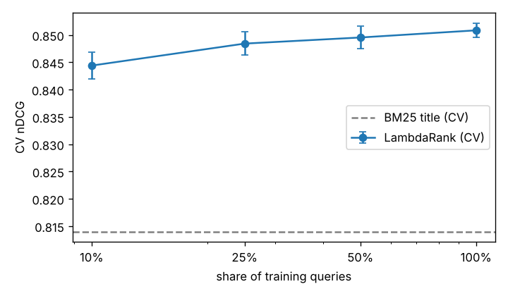
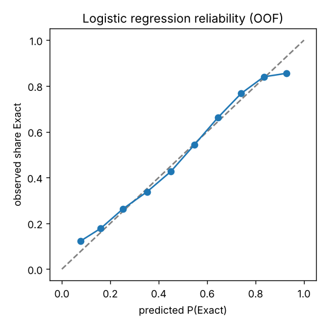

# Report 4 — Extra analyses (Phase 7, optional)

Each analysis is labelled with the data it uses. None of them influenced model selection.

## 1. Learning curve — *training-split CV*

LambdaRank with the CV-selected configuration, trained on a seeded subsample of each fold's training queries and validated on the full validation fold. Fitted features (BM25 statistics, brand vocabulary) still use the fold's full training part: only the number of *labelled* queries varies.

| Share of training queries | Queries per fold | CV nDCG (mean ± std) |
|---|--:|---|
| 10% | 1,671 | 0.8444 ± 0.0024 |
| 25% | 4,177 | 0.8484 ± 0.0021 |
| 50% | 8,355 | 0.8495 ± 0.0020 |
| 100% | 16,711 | 0.8508 ± 0.0013 |

BM25-title CV nDCG for reference: 0.8140.

## 2. Calibration of logistic-regression probabilities — *training-split CV, out-of-fold*

Brier score 0.2180 (always predicting the base rate: 0.2455).

| Predicted bin | Pairs | Mean predicted | Observed share Exact |
|---|--:|--:|--:|
| 0.0–0.1 | 3,711 | 0.077 | 0.122 |
| 0.1–0.2 | 27,811 | 0.161 | 0.178 |
| 0.2–0.3 | 67,242 | 0.253 | 0.264 |
| 0.3–0.4 | 82,023 | 0.351 | 0.337 |
| 0.4–0.5 | 88,738 | 0.450 | 0.426 |
| 0.5–0.6 | 76,484 | 0.547 | 0.543 |
| 0.6–0.7 | 49,268 | 0.644 | 0.662 |
| 0.7–0.8 | 19,745 | 0.740 | 0.767 |
| 0.8–0.9 | 4,010 | 0.834 | 0.840 |
| 0.9–1.0 | 621 | 0.928 | 0.855 |

## 3. Sensitivity to gains — *POST-HOC, frozen test predictions*

Same rankings, different gain values in the metric. Labelled post-hoc: chosen after seeing the test results, so it is descriptive only.

| Gains | Random | BM25 title | Chosen model | Model − BM25 title [95% CI] |
|---|---|---|---|---|
| official (E=1, S=0.1, C=0.01) | 0.7469 | 0.8176 | 0.8538 | +0.0362 [+0.0337, +0.0386] |
| lenient (E=1, S=0.5, C=0.25) | 0.8498 | 0.8912 | 0.9127 | +0.0215 [+0.0199, +0.0231] |
| exact only (E=1, others 0) | 0.7041 | 0.7874 | 0.8295 | +0.0421 [+0.0393, +0.0450] |
